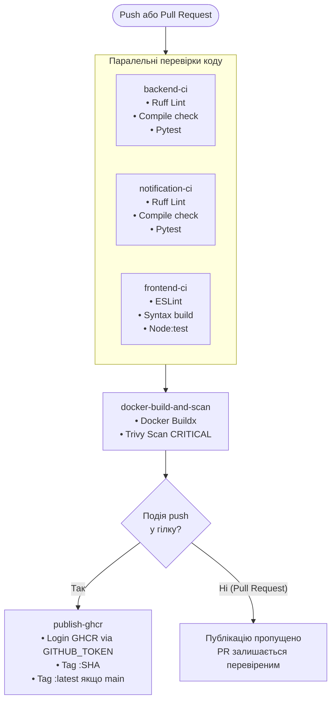

# Лабораторна робота №2 — Continuous Integration (CI/CD)
## Предмет: Технології DevOps
## Тема: Безперервна інтеграція та автоматизація перевірок (CI)

---

## A. Мета роботи

**Continuous Integration (CI)** — це методологія розробки програмного забезпечення, що полягає в постійному та автоматизованому злитті робочих копій коду розробників у спільну основну гілку, де кожна зміна супроводжується автоматичним запуском лінтерів, компіляції та тестів.

**Мета цієї лабораторної роботи:**
1. Побудувати повноцінний автоматизований CI/CD-пайплайн для мікросервісного застосунку **DevOps Task Manager** за допомогою **GitHub Actions**.
2. Організувати паралельне тестування, лінтинг та перевірку збірки для кожного сервісу (`backend`, `notification-service`, `frontend`).
3. Налаштувати автоматичне кешування пакетів (pip для Python, npm для Node.js) та Docker-шарів для прискорення пайплайну.
4. Налаштувати перевірку безпеки образів за допомогою сканера вразливостей **Trivy**.
5. Налаштувати безпечну публікацію контейнерних образів у **GitHub Container Registry (GHCR)** із версіонуванням за commit SHA та тегом `latest`.
6. Реалізувати захист основної гілки (**Branch Protection Rules**) із обов'язковими перевірками (**Required Status Checks**).
7. Продемонструвати блокування Pull Request при наявності помилок у коді.

---

## B. Архітектура та компоненти системи

Проєкт побудований на мікросервісній архітектурі та містить такі компоненти:

| Сервіс | Технологічний стек | Порт (контейнер / хост) | Тестування | Статичний аналіз (Лінтер) | Dockerfile | Роль у системі |
|---|---|---|---|---|---|---|
| **backend** | Python 3.12, FastAPI, SQLAlchemy | 8000 / 8000 | `pytest`, `pytest-asyncio` (7 тестів) | `ruff` (pyproject.toml) | `backend/Dockerfile` | Головний REST API керування завданнями, взаємодія з PostgreSQL та notification |
| **notification-service** | Python 3.12, FastAPI, Pydantic | 8001 / 8001 | `pytest` (4 тести) | `ruff` (pyproject.toml) | `notification-service/Dockerfile` | Мікросервіс аудиту та сповіщень про створення/зміну завдань |
| **frontend** | HTML5, CSS3, JavaScript (ES6+), Nginx | 80 / 8080 | Вбудований тест-раннер `node:test` (3 тести) | `eslint` 9 (flat config) | `frontend/Dockerfile` | Веб-інтерфейс користувача, який обслуговується сервером Nginx |
| **db** | PostgreSQL 16 Alpine | 5432 / 5433 | Healthcheck `pg_isready` | — | Офіційний образ `postgres:16-alpine` | Реляційне сховище завдань |

Всі 4 сервіси об'єднані в локальному середовищі за допомогою `docker-compose.yml`.

---

## C. Структура файлів

При виконанні лабораторної роботи №2 додано та оновлено такі файли:

- `.github/workflows/ci.yml` — конфігурація GitHub Actions workflow для автоматизації перевірок, збірки Docker та публікації в GHCR.
- `pyproject.toml` — централізована конфігурація лінтера Ruff для Python-сервісів (налаштовано правила `E`, `W`, `F`, `I`, `UP`, `SIM` та виключення `B008` для ідіоми FastAPI `Depends`).
- `backend/requirements.txt` — додано `ruff` для можливості локального запуску лінтера.
- `backend/app/models.py`, `backend/app/main.py`, `backend/tests/test_api.py` — відформатовано код, виправлено сортування імпортів, оптимізовано контекстні менеджери тестів та приведено до сучасного стандарту `datetime.UTC`.
- `notification-service/requirements.txt` — додано `ruff` для лінтингу сервісу сповіщень.
- `notification-service/app/main.py`, `notification-service/tests/test_api.py` — виправлено імпорти та стандартизовано код відповідно до вимог PEP8/Ruff.
- `frontend/package.json` — додано дескриптор проєкту фронтенду зі скриптами `build`, `lint` (`eslint`) та `test` (`node:test`).
- `frontend/package-lock.json` — зафіксовані залежності фронтенду для детермінованого встановлення через `npm ci` та кешування в CI.
- `frontend/eslint.config.mjs` — сучасна конфігурація ESLint 9 (Flat Config) для статичного аналізу JavaScript-коду браузера та тестів.
- `frontend/app.js` та `frontend/config.js` — модуль адаптовано для безпечного виконання як у браузері через Nginx, так і в середовищі Node.js під час тестів.
- `frontend/tests/app.test.js` — повноцінні unit-тести для перевірки санітизації HTML (`escapeHtml`) та налаштувань API.
- `frontend/.dockerignore`, `backend/.dockerignore`, `notification-service/.dockerignore` — оптимізація контексту збірки Docker (виключення кешів, `.venv`, `node_modules`).
- `docs/LAB2_CI_DEMO.md` — цей детальний документ інструкцій та демонстрації.

---

## D. Як працює CI (Continuous Integration)

### 1. Тригери запуску (Triggers)
- **`push` у будь-яку гілку (`branches: ['**']`)**: перевіряє будь-який комміт, надісланий у віддалений репозиторій.
- **`pull_request` (типи: `opened`, `synchronize`, `reopened`)**: запускає перевірки при створенні PR, додаванні нових коммітів або повторному відкритті PR.
- **`workflow_dispatch`**: дозволяє запускати пайплайн вручну через інтерфейс GitHub Actions.

### 2. Етапи пайплайну (Jobs)
1. **`backend-ci`**, **`notification-ci`**, **`frontend-ci`** запускаються **паралельно та незалежно**:
   - `actions/checkout@v7`: отримання коду.
   - `actions/setup-python@v7` або `actions/setup-node@v7`: розгортання відповідного середовища (Python 3.12 / Node.js 20).
   - Автоматичне кешування залежностей (`cache: pip`, `cache: npm`).
   - Встановлення залежностей (`pip install -r ...`, `npm ci`).
   - Лінтер (`ruff check`, `npm run lint`).
   - Перевірка синтаксичної збірки (`compileall`, `node -c`).
   - Тести (`pytest -v`, `npm test`).
2. **`docker-build-and-scan`** (залежить від `needs: [backend-ci, notification-ci, frontend-ci]`):
   - Запускається matrix-стратегією для 3 сервісів одночасно.
   - Створює образ за допомогою Docker Buildx.
   - Запускає **Trivy** (`aquasecurity/trivy-action@v0.36.0`) для виявлення CRITICAL-вразливостей (`exit-code: 1`).
3. **`publish-ghcr`** (залежить від `needs: [docker-build-and-scan]`, умова: `github.event_name == 'push'`):
   - **Ніколи не публікує образи для Pull Request**!
   - Автентифікується в GHCR за допомогою вбудованого `GITHUB_TOKEN` із правами `packages: write`.
   - Генерує унікальний тег за commit SHA: `ghcr.io/<owner>/taskmanager-<service>:<sha>`.
   - Додає тег `latest` **виключно для основної гілки (`main`)**.

### 3. Діаграма пайплайну (Mermaid)



---

## E. Як запустити перевірки локально

Всі перевірки, які виконує GitHub Actions, можна запустити локально на комп'ютері:

### 1. Перевірка Backend
```powershell
# Перейти в директорію backend
cd backend

# Встановити залежності (якщо не встановлені)
pip install -r requirements.txt

# Запустити лінтер Ruff
ruff check .

# Запустити тести
pytest -v

cd ..
```

### 2. Перевірка Notification Service
```powershell
# Перейти в директорію notification-service
cd notification-service

# Запустити лінтер Ruff
ruff check .

# Запустити тести
pytest -v

cd ..
```

### 3. Перевірка Frontend
```powershell
# Перейти в директорію frontend
cd frontend

# Встановити точні версії залежностей
npm ci

# Запустити перевірку синтаксису (Build)
npm run build

# Запустити лінтер ESLint
npm run lint

# Запустити unit-тести
npm test

cd ..
```

### 4. Перевірка конфігурації Docker Compose
```powershell
# Перевірка синтаксису та структури композу
docker compose config
```

### 5. Повний запуск стеку через Docker Compose
> **Увага:** Для виконання цієї команди необхідно, щоб був запущений Docker Desktop.
```powershell
# Зібрати образи та запустити всі сервіси у фоні
docker compose up -d --build

# Перевірити статус контейнерів
docker compose ps

# Перевірити логи
docker compose logs backend
docker compose logs notification

# Зупинити стек
docker compose down
```

---

## F. Як перевірити GitHub Actions

1. Перейдіть до свого репозиторію на GitHub.
2. Відкрийте вкладку **Actions** у верхньому меню.
3. У лівій колонці виберіть workflow **CI/CD Pipeline**.
4. У списку запусків натисніть на останній комміт або запуск.
5. Ви побачите візуальний граф з усіма jobs:
   - `Backend CI (Lint, Test, Build)`
   - `Notification Service CI (Lint, Test, Build)`
   - `Frontend CI (Lint, Test, Build)`
   - `Docker Build & Vulnerability Scan (backend)`
   - `Docker Build & Vulnerability Scan (notification)`
   - `Docker Build & Vulnerability Scan (frontend)`
   - `Publish to GHCR (...)` (якщо це була подія `push`).
6. Натиснувши на будь-який job, можна розгорнути кроки та переглянути детальні логи компіляції, роботи лінтера, виведення `pytest` або сканування Trivy.

---

## G. Як опублікувати образи в GHCR

Пайплайн налаштовано так, що публікація виконується автоматично при `git push`:
1. Використовується офіційний реєстр `ghcr.io`.
2. Автентифікація здійснюється через системну змінну `${{ secrets.GITHUB_TOKEN }}`. Вона не вимагає ручного введення паролів чи створення Personal Access Token (PAT).
3. Права надаються директивою:
   ```yaml
   permissions:
     packages: write
     contents: read
   ```
4. Формат імені пакета:
   - `ghcr.io/<owner>/taskmanager-backend:<sha>`
   - `ghcr.io/<owner>/taskmanager-notification:<sha>`
   - `ghcr.io/<owner>/taskmanager-frontend:<sha>`
   - Додатково для коммітів у гілку `main` створюється тег `:latest`.

### Налаштування видимості пакета в GitHub (Public):
За замовчуванням пакети в GHCR створюються приватними. Щоб зробити їх публічними (за потреби викладача):
1. На сторінці вашого профілю або організації GitHub відкрийте вкладку **Packages**.
2. Оберіть опублікований пакет (наприклад, `taskmanager-backend`).
3. Перейдіть у **Package settings** (у правій колонці).
4. Прокрутіть до розділу **Danger Zone** -> натисніть **Change package visibility** -> виберіть **Public** -> підтвердіть дію.

---

## H. Як завантажити й запустити опубліковані образи

Оскільки бекенд вимагає працюючу базу даних PostgreSQL, а фронтенд — працюючі бекенди, найзручніший спосіб розгортання — використання Docker Compose з посиланням на опубліковані образи.

### Запуск одного автономного сервісу (наприклад, notification-service):
```powershell
# Завантажити образ (замініть USERNAME на ваш GitHub логін у нижньому регістрі)
docker pull ghcr.io/USERNAME/taskmanager-notification:latest

# Запустити контейнер
docker run -d --name test-notification -p 8001:8001 ghcr.io/USERNAME/taskmanager-notification:latest

# Перевірити доступність
curl http://localhost:8001/health
```

### Запуск усього стеку з GHCR через Compose:
Для цього в `docker-compose.yml` секції `build` можна замінити на `image: ghcr.io/USERNAME/taskmanager-<service>:latest`:
```powershell
docker compose pull
docker compose up -d
```

---

## I. Налаштування захисту основної гілки (Branch Protection Rules)

Щоб гарантувати, що в гілку `main` ніколи не потрапить зламаний код, необхідно налаштувати Branch Protection у репозиторії GitHub.

### Покрокова інструкція:
1. Перейдіть у репозиторій на GitHub.
2. Відкрийте вкладку **Settings** -> у лівому бічному меню виберіть **Branches** (або **Rules** -> **Rulesets**).
3. У розділі **Branch protection rules** натисніть кнопку **Add branch protection rule** (або **New ruleset**).
4. У полі **Branch name pattern** введіть: `main`.
5. Увімкніть такі обов'язкові правила:
   - ☑ **Require a pull request before merging** (вимагати Pull Request для злиття змін).
     - Рекомендовано: зняти або залишити галочку *Require approvals* (якщо ви працюєте над лабораторною самостійно).
   - ☑ **Require status checks to pass before merging** (вимагати успішного проходження CI-перевірок).
   - ☑ **Require branches to be up to date before merging** (вимагати актуальності гілки перед злиттям).
6. У полі пошуку перевірок (**Status checks that are required**) знайдіть та додайте такі точні назви jobs:
   - `Backend CI (Lint, Test, Build)`
   - `Notification Service CI (Lint, Test, Build)`
   - `Frontend CI (Lint, Test, Build)`
   - `Docker Build & Vulnerability Scan (backend)`
   - `Docker Build & Vulnerability Scan (notification)`
   - `Docker Build & Vulnerability Scan (frontend)`
7. Натисніть **Create** (або **Save changes**).

Тепер будь-яка спроба зробити прямий `git push origin main` буде відхилена, а злиття PR буде можливим тільки якщо всі checks стануть "зеленими".

---

## J. Сценарій демонстрації викладачеві (5–10 хвилин)

Ось покроковий план, який показує володіння інструментами CI/CD:

### Крок 1. Показати структуру проєкту та CI workflow (1-2 хв)
- Відкрийте в редакторі або на GitHub файл `.github/workflows/ci.yml`.
- Поясніть викладачеві:
  * Тригери (`push`, `pull_request`).
  * 3 незалежні паралельні jobs для тестування мікросервісів з кешуванням залежностей.
  * Блокуючий етап збірки Docker та перевірки на вразливості через Trivy.
  * Умову публікації образів тільки для `push` у гілку.

### Крок 2. Продемонструвати заблокований Pull Request (Червоний CI) (2-3 хв)
1. Створіть нову гілку для демонстрації помилки:
   ```bash
   git checkout -b test-ci-failure
   ```
2. Внесіть навмисну помилку в тест або код. Наприклад, у файлі `backend/tests/test_api.py` змініть очікуваний статус у тесті `test_health`:
   ```python
   # Змініть 200 на 500
   assert response.status_code == 500
   ```
3. Зробіть комміт і надішліть у GitHub:
   ```bash
   git add backend/tests/test_api.py
   git commit -m "test: introduce intentional test failure"
   git push -u origin test-ci-failure
   ```
4. Відкрийте GitHub і створіть **Pull Request** з гілки `test-ci-failure` в `main`.
5. Перейдіть на сторінку PR:
   - Покажіть, як запускаються Checks.
   - Job `Backend CI (Lint, Test, Build)` впаде з помилкою (червоний хрестик).
   - Кнопка **Merge pull request** буде **заблокована** сірим кольором із попередженням: *"Required statuses must pass before merging"*.

### Крок 3. Виправити помилку і розблокувати PR (Зелений CI) (2 хв)
1. Поверніть правильний код у `backend/tests/test_api.py`:
   ```python
   assert response.status_code == 200
   ```
2. Зробіть комміт та push:
   ```bash
   git add backend/tests/test_api.py
   git commit -m "fix: restore valid healthcheck assertion"
   git push origin test-ci-failure
   ```
3. Поверніться на сторінку Pull Request:
   - GitHub автоматично перезапустить CI pipeline для нового комміту.
   - Всі перевірки пройдуть успішно (зелені галочки).
   - Кнопка **Merge pull request** стане активною та зеленою.
4. Натисніть **Merge pull request** -> **Confirm merge**.

### Крок 4. Показати публікацію образів у GHCR (1-2 хв)
1. Перейдіть у вкладку **Actions**: після злиття в `main` запуститься пайплайн для події `push: main`.
2. Покажіть, що тепер виконався крок `publish-ghcr`.
3. Перейдіть на головну сторінку профілю/репозиторію у розділ **Packages** і покажіть створені образи з тегами `:latest` та комміт-хешем `:sha`.

---

## K. Контрольні запитання викладача та відповіді

### 1. Що таке CI?
**Відповідь:** Continuous Integration (безперервна інтеграція) — це практика автоматизації злиття коду всіх розробників у спільну гілку, де кожна зміна автоматично збирається, лінтується та тестується для швидкого виявлення помилок.

### 2. Чим CI відрізняється від CD?
**Відповідь:** CI відповідає за перевірку коду (компіляція, лінтинг, тестування, збірка артефактів), тоді як CD (Continuous Delivery або Deployment) відповідає за автоматичну доставку та розгортання перевірених артефактів на тестові (staging) або робочі (production) сервери.

### 3. Що таке GitHub Actions workflow?
**Відповідь:** Це автоматизований процес, описаний у YAML-файлі в директорії `.github/workflows/`, який складається з одного або кількох jobs і запускається за визначеними подіями (наприклад, `push`, `pull_request`).

### 4. Що таке job і step у GitHub Actions?
**Відповідь:** **Job** — це набір кроків, що виконується на одному віртуальному середовищі (runner). Jobs можуть запускатися паралельно або за чергою. **Step** — це окрема команда (shell-скрипт) або дія (action) всередині job.

### 5. Що таке runner?
**Відповідь:** Runner — це сервер/віртуальна машина із встановленим агентом GitHub Actions Runner, яка завантажує workflow, виконує зазначені команди та надсилає результати назад у GitHub (наприклад, `ubuntu-latest` або self-hosted runner).

### 6. Для чого потрібен Pull Request?
**Відповідь:** Pull Request — це механізм пропозиції змін із гілки розробки в цільову гілку (наприклад, `main`), який дозволяє провести код-рев'ю, автоматичні CI-перевірки та обговорення коду до його фактичного злиття.

### 7. Що таке unit-тести та integration-тести?
**Відповідь:** **Unit-тести** перевіряють роботу окремих ізольованих функцій або класів (наприклад, `escapeHtml` або валідація схеми Pydantic). **Integration-тести** перевіряють взаємодію кількох компонентів системи між собою (наприклад, роботу API ендпоінта з базою даних).

### 8. Навіщо потрібен лінтер?
**Відповідь:** Лінтер (наприклад, Ruff або ESLint) аналізує вихідний код без його запуску (статичний аналіз) для виявлення синтаксичних помилок, потенційних багів, антипатернів, невикористаних змінних та порушень стандартів оформлення коду (PEP8, Clean Code).

### 9. Для чого використовується кешування залежностей?
**Відповідь:** Щоб не завантажувати повторно сотні мегабайт пакетів (з PyPI або npm) при кожному комміті. Кешування зберігає папку з пакетами між запусками CI, скорочуючи час виконання пайплайну з кількох хвилин до кількох секунд.

### 10. Чим Docker-образ відрізняється від контейнера?
**Відповідь:** **Образ (Image)** — це статичний незмінний шаблон, який містить файлову систему, залежності та інструкції для запуску програми. **Контейнер (Container)** — це запущений у пам'яті ізольований процес, створений на основі цього образу.

### 11. Для чого потрібен GHCR?
**Відповідь:** GitHub Container Registry (GHCR) — це сховище (реєстр) контейнерних образів Docker, інтегроване безпосередньо в екосистему GitHub, що дозволяє безпечно зберігати, версіонувати та розповсюджувати образи за допомогою стандартних прав GitHub.

### 12. Навіщо потрібні теги SHA та latest?
**Відповідь:** Тег із commit **SHA** гарантує незмінність (immutability) і повну відтворюваність: можна запустити точну версію образу для будь-якого конкретного комміту. Тег **latest** є динамічним покажчиком на найостанніший стабільний реліз з основної гілки.

### 13. Для чого потрібні secrets?
**Відповідь:** GitHub Secrets використовуються для безпечного збереження конфіденційних даних (паролі, токени API, приватні ключі), щоб вони не потрапляли у відкритий код репозиторію і автоматично маскувалися в логах CI.

### 14. Що таке Branch Protection Rules і required status checks?
**Відповідь:** Це правила захисту гілки (зазвичай `main`), які забороняють прямий `push` або злиття Pull Request, якщо визначені перевірки (status checks) пайплайну не завершилися успішно.

### 15. Як працює залежність needs між jobs?
**Відповідь:** Ключове слово `needs` вказує, які jobs мають завершитися успішно перед стартом поточного job. Якщо залежний job падає, наступні автоматично скасовуються. За відсутності `needs` всі jobs виконуються паралельно.

### 16. Навіщо сканувати образи на вразливості?
**Відповідь:** Сканування (наприклад, через Trivy) перевіряє системні пакети ОС та бібліотеки залежностей на наявність відомих CVE-вразливостей, запобігаючи розгортанню вразливих контейнерів у production-середовищі.

---

## L. Підсумок виконання

### 1. Реально виконано та перевірено локально:
- [x] Проведено повний аудит мікросервісного проєкту (`backend`, `notification-service`, `frontend`, `db`).
- [x] Налаштовано та протестовано лінтер **Ruff** для Python-сервісів через `pyproject.toml`.
- [x] Виправлено всі 16 зауважень статичного аналізу в коді та тестах Python.
- [x] Додано конфігурацію **ESLint 9** та вбудований тест-раннер **Node.js** для фронтенду.
- [x] Успішно виконано всі 7 тестів бекенду (`pytest`), 4 тести сервісу сповіщень (`pytest`) та 3 тести фронтенду (`node:test`).
- [x] Перевірено синтаксичну збірку (компіляцію) Python (`compileall`) та JavaScript (`node -c`).
- [x] Перевірено конфігурацію `docker-compose.yml` (`docker compose config` завершився з кодом 0).
- [x] Створено та синтаксично перевірено файл `.github/workflows/ci.yml`.
- [x] Створено файли `.dockerignore` для запобігання потраплянню сміття в образи.
- [x] Ініціалізовано локальний Git-репозиторій із гілкою `main`.

### 2. Налаштовано в конфігурації, але потребує виконання на GitHub:
- [x] Складання Docker-образів через Buildx і кешування GitHub Actions (`type=gha`).
- [x] Сканування образів на вразливості Trivy для виявлення вразливостей з критичністю CRITICAL.
- [x] Автоматична публікація образів у `ghcr.io` за комміт-хешем і тегом `latest`.
- [x] Запуск перевірок у розділі **Checks** при створенні Pull Request.

### 3. Дії, які користувач має виконати власноруч у GitHub:
1. **Створити репозиторій на GitHub** (наприклад, з назвою `devops-task-manager`).
2. **Додати віддалений репозиторій та надіслати код**:
   ```bash
   git add .
   git commit -m "feat: complete lab 2 continuous integration setup"
   git remote add origin https://github.com/<ВАШ_НІК>/devops-task-manager.git
   git branch -M main
   git push -u origin main
   ```
3. **Увімкнути Branch Protection Rules** для гілки `main` відповідно до розділу **I** цієї інструкції.
4. **Виконати сценарій демонстрації блокування PR** (розділ **J**) для викладача.
